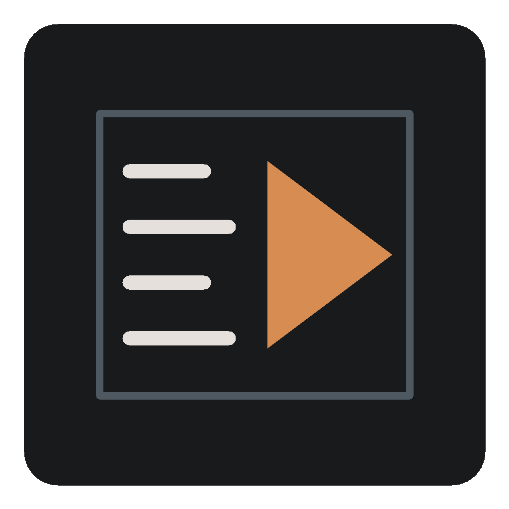
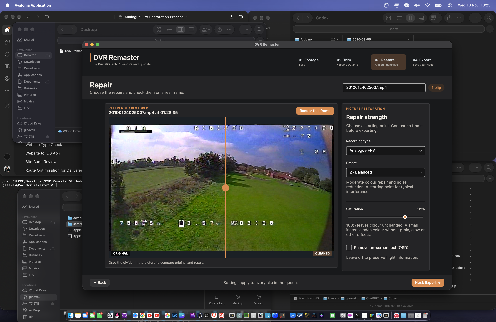
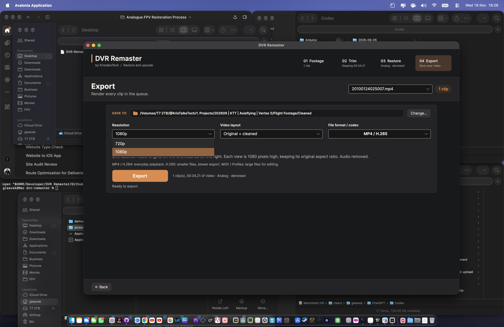

# DVR Remaster

**Restore. Enhance. Preserve.**

Developed by **Kris Gleave (KrisTalksTech)** for the FPV community, based on FPV DVR Cleaner by David-Andreas Tornow and contributors.

**v1.0.0 — Free and open-source FPV DVR restoration for Mac.**

[Releases](https://github.com/krisgleave/dvr-remaster/releases) · [User guide](docs/USER_GUIDE.md) · [Installation](docs/INSTALLATION.md) · [Release notes](RELEASE_NOTES.md) · [Support](SUPPORT.md) · [Report an issue](https://github.com/krisgleave/dvr-remaster/issues)

## Why I developed it

As an FPV pilot and YouTuber, I wanted to clean up my analogue DVR footage so it looked better in reviews, flight tests and build videos. DVR Remaster grew around that workflow: compare the result, adjust restoration, trim useful sections and export them for editing. It is free and open source for the community, with no subscription. All video processing happens locally.

## Screenshots

Comparison, trimming and export

## Features

- Analogue colour-dropout and rainbow-interference repair using neighbouring frames.
- HDZero/digital breakup restoration mode.
- Repair strength, sharpness, saturation and contrast controls, editable numeric values, preset reference markers and individual/all resets.
- Built-in restoration presets and saved custom presets.
- Optional **Preserve OSD** protection.
- Original/restored preview comparison, playback, seeking and frame stepping.
- Multiple source recordings, trimming and multiple queued sections from the same recording.
- Per-section restoration settings and OSD protection, with pencil edit and red trash controls.
- Separate numbered batch exports, custom filenames and collision-safe output naming.
- MP4 H.264, MP4 H.265/HEVC and MOV ProRes 422 output.
- Original resolution, HD (1080 high), 2K (1440 high) and 4K (2160 high), preserving source display aspect ratio.
- Restored single-panel or labelled original/restored side-by-side exports.
- Optional audio removal, progress, estimated processing time/file size, cancellation and Finder reveal.

The current interface does not expose the inherited engine's MKV/WebM export, OSD removal, model training or social-media reframing tools. Queued sections export separately, not as one joined movie.

## Get started

1. Download **DVR-Remaster-1.0.0-Mac.zip** from Releases. **Code → Download ZIP** is source code.
2. Unzip and move **DVR Remaster.app** into Applications.
3. Open a recording, choose the signal type and start with a balanced preset.
4. Compare a few frames and adjust repair, sharpness, saturation and contrast.
5. Trim a section and click **Add to queue**. Repeat for other sections or recordings.
6. Open **Queue** to review or edit each section, then **Export video** to choose format, resolution, layout, audio and destination.

See the [full guide](docs/USER_GUIDE.md). Source recordings are retained.

## Preserve OSD: try both settings

Enabled, this attempts to identify stationary text/graphics and restore those pixels from the original after processing. It can keep telemetry readable, but scene details can be mistaken for OSD and left untreated. Disabled, restoration can act on the whole image and may produce a cleaner result, but can soften or alter OSD elements. Detection is visual, not recognition of telemetry values, and cannot guarantee every changing warning is protected. Compare short exports with protection on and off for your footage.

## How restoration works

The analogue engine separates brightness from colour. It detects weak colour/dropouts, abrupt colour stripes and colour boundaries unsupported by brightness edges. Optical flow aligns nearby frames; brightness agreement and outlier rejection determine which colour evidence to trust. Local brightness-to-colour estimation helps some persistent bands. Where evidence is insufficient, interference may remain. Preset-dependent noise reduction/fusion and finishing adjustments follow. OSD protection blends detected original pixels back into the processed frame.

This describes [analog.py](src/flugbild/analog.py), [restoration.py](src/flugbild/restoration.py), [osd.py](src/flugbild/osd.py), [upscale.py](src/flugbild/upscale.py) and [look.py](src/flugbild/look.py). It is not generative AI detail recovery. Motion, severe breakup and genuinely missing information limit results; upscaling cannot turn an analogue recording into native 4K detail.

## Requirements and compatibility

The local package targets **Apple Silicon macOS** and includes its engine and FFmpeg. No separate Python, .NET or FFmpeg installation is intended for end users. Current validation used macOS 27.2.1. The minimum target is macOS 14.0 (Sonoma). Earlier macOS versions, Intel Macs, Windows and Linux are not supported by this release. Testing on macOS 14 itself is still pending. See [compatibility](docs/COMPATIBILITY.md).

## Other free KrisTalksTech apps

| Original product artwork | App |
|---|---|
|  | [OSD Editor](https://github.com/krisgleave/osd-editor) — edit supported recorded OSD and telemetry. |
|  | [P1 File Transfer](https://github.com/krisgleave/p1-transfer) — copy P1 recordings and sidecars to your Mac. |

## Support

[Subscribe to KrisTalksTech on YouTube](https://www.youtube.com/@kristalkstech) for FPV content and reviews. [PayPal support](https://www.paypal.me/krisgleave) is optional; the app remains free. Testing, useful bug reports and contributions are welcome.

## Credits and licence

DVR Remaster is licensed under **GPL-3.0-or-later**. The original MIT licence and copyright of David-Andreas Tornow (Bratwurstexe) and FPV DVR Cleaner contributors are preserved in [licenses/FPV-DVR-Cleaner-MIT.txt](licenses/FPV-DVR-Cleaner-MIT.txt). DVR Remaster modifications are by Kris Gleave, assisted by OpenAI Codex.

Third-party dependencies retain their own licences. The macOS release uses custom FFmpeg, OpenCV and Python builds. See [third-party notices](THIRD-PARTY-NOTICES.md), [copyright](COPYRIGHT.md) and [branding](BRANDING.md).
