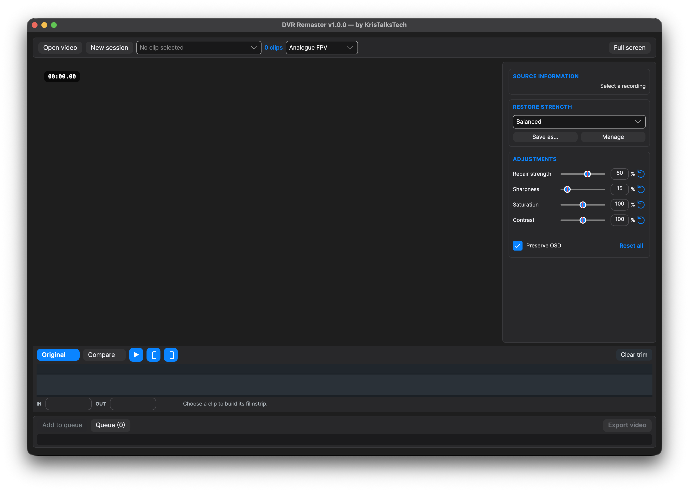
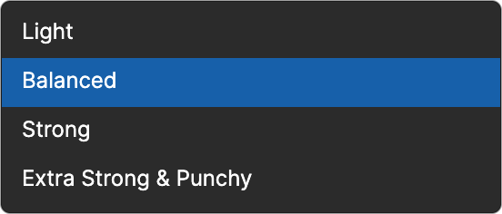
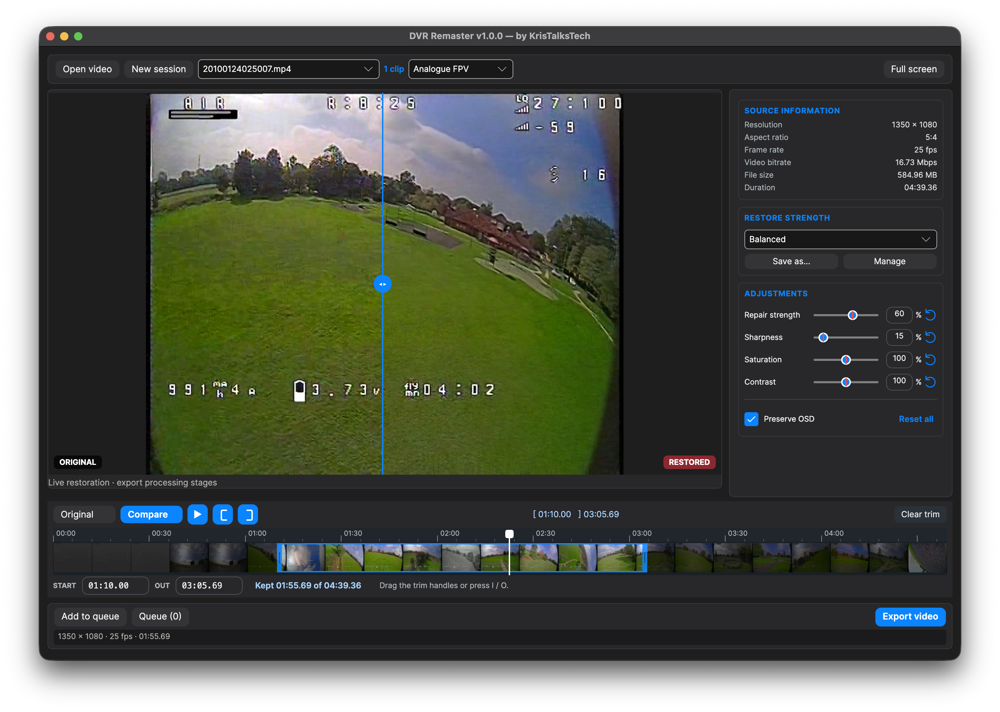
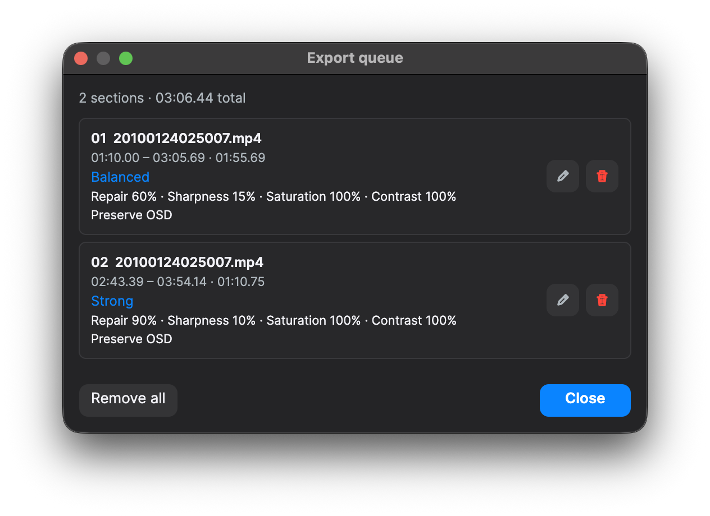
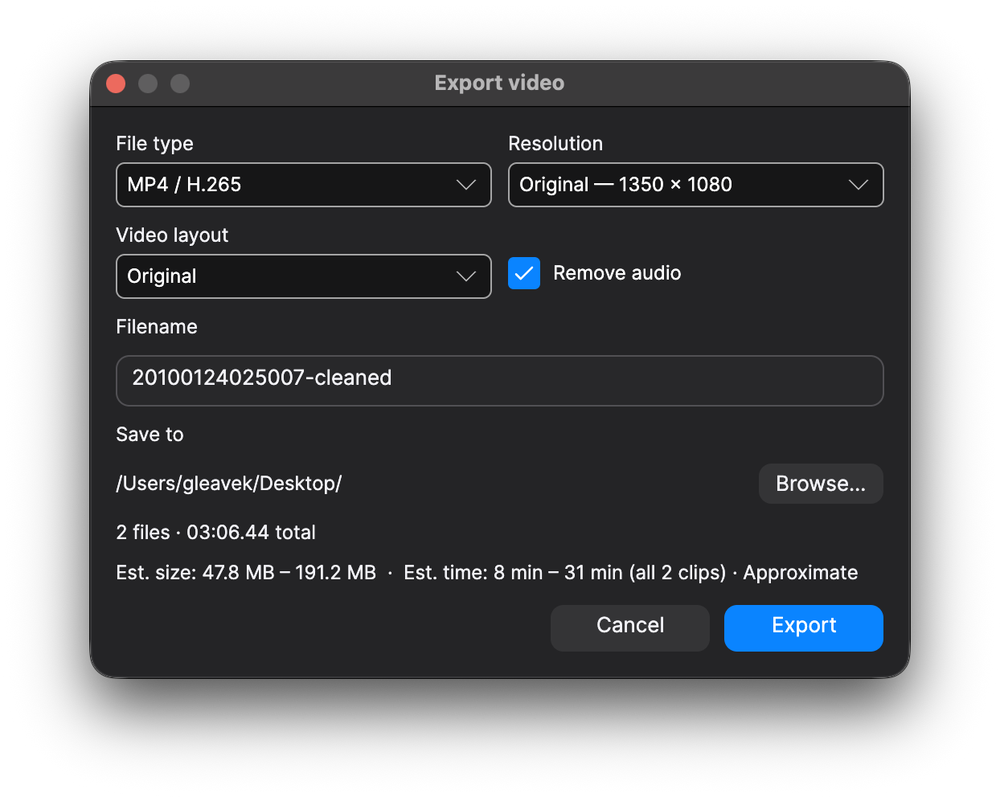
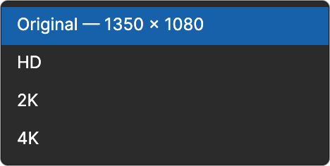
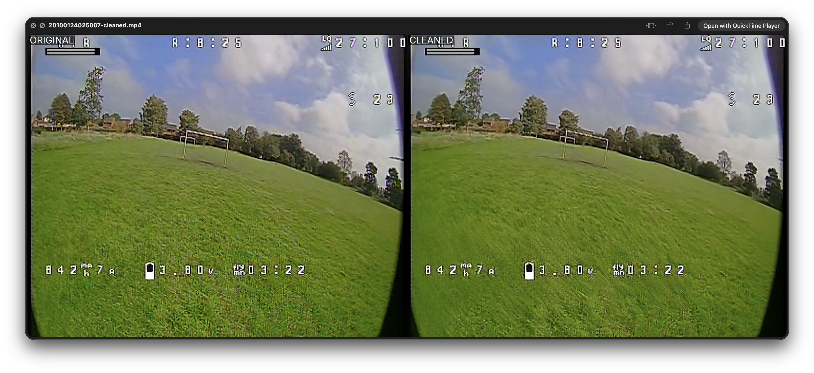

# DVR Remaster v1.0.0 user guide

## Import and preview

Open one or more supported recordings (MP4, MOV, MKV, AVI, M4V, TS or WebM). Container support depends on the codecs FFmpeg can decode. Select the recording you want to work on. Use playback, the timeline and frame-step controls to inspect damaged moments and compare the original with the restored preview. Preview rendering may take time after changes.

*The main workspace before importing a recording.*

## Restoration

Choose Analogue or HDZero/digital to match the recording, then a built-in preset. Start with Balanced and increase strength only where it helps. Repair controls interference treatment; sharpness emphasises edges; saturation changes colour intensity; contrast changes tonal separation. Type a numeric value and press Enter or leave the field to apply it. Values are clamped to the slider limits. Markers show the selected preset's reference values. Individual reset buttons restore one value; Reset all restores the adjustment values.

*Choose from Light, Balanced, Strong or Extra Strong & Punchy.*

Save a custom preset under a unique name for reuse. Presets and personal settings are stored separately from the app. Use the preset management controls to manage your saved choices.

## Preserve OSD

Enable Preserve OSD to protect detected original text/graphic pixels. The detector looks for visual features that remain in place; it does not read flight telemetry. Static scenery can be mistaken for OSD and retain interference. Disabling protection allows more uniform restoration but may alter or soften the text. Compare short exports both ways, especially around warnings, fast motion and stationary scenes. Protection is not OSD removal; the current interface does not offer removal.

## Trim and queue

Set the section's start and end using the trim controls. Click Add to queue to capture the section with its current restoration and OSD-protection settings. Change the trim and add another section, or select another recording and repeat. The same recording can appear several times.

*Drag the comparison slider to inspect restoration results and use the timeline to select a section for export.*

Open Queue to review section durations and settings. The pencil edits that section's restoration settings; Save applies them and Cancel leaves them unchanged. The red trash icon removes only that queue entry. Remove all clears the export queue; neither operation deletes recordings. Sections export to separate files. They are not joined into one movie.

*Each queued section retains its own restoration settings and can be edited or removed individually.*

## Export

Click Export video and review:

*Choose the file type, resolution, video layout, audio settings, filename and destination.*

| Setting | Meaning |
|---|---|
| MP4 / H.264 | General playback and editing compatibility. |
| MP4 / H.265 | HEVC encoding; playback support depends on your editor/device. |
| MOV / ProRes 422 | Editing intermediate; expect larger files. |
| Original resolution | Source display aspect ratio and source height. |
| HD / 2K / 4K | 1080 / 1440 / 2160 pixel height; width follows source display aspect ratio. No invented detail. |
| Original layout | Single restored picture, not an unprocessed original copy. |
| Side by side | Original on the left, restored on the right, with labels; wider output. |
| Remove audio | Checked means silent output; clear it to retain source audio where present. |
| Filename | Base name; multiple queued outputs receive _1, _2, etc. Existing names get an additional suffix. |
| Save to | Destination folder chosen with Browse. |

### Output resolution

*Keep the original resolution or upscale to HD, 2K or 4K while preserving the source display aspect ratio.*

### Side-by-side video export

*Choose Side by side under Video layout to export a comparison video with the original footage on the left and the restored footage on the right.*

Export format, size, layout and audio choices apply to the batch. Restoration settings are retained per queued section. Check Remove audio each session: it starts enabled. Size and time estimates are approximate and depend on content and previous processing samples.

Wait for the completed-file count. Cancel export stops ongoing work; completed files are retained. Successfully verified entries leave the queue, while unfinished entries remain available to retry. Reveal in Finder opens the output location; Play video is shown for a single finished output. Review results in your editor before using them in a final video.

## Troubleshooting and limitations

- No output: check destination access and disk space, then try a short H.264 export.
- Result looks too strong: reduce repair/sharpness or try another preset; compare OSD protection on/off.
- Estimated time changes: export speed varies with motion, resolution and restoration settings.
- High-resolution export: allow space for temporary processing files as well as the finished video.
- Missing colour/detail: neighbouring frames cannot recover information that was never recorded.
- Keep original files. Repeatedly processing an already encoded result can add artefacts.

For reports, include app version, macOS/Mac model, input dimensions/frame rate, settings and steps to reproduce. Do not post private recordings or location telemetry publicly.
